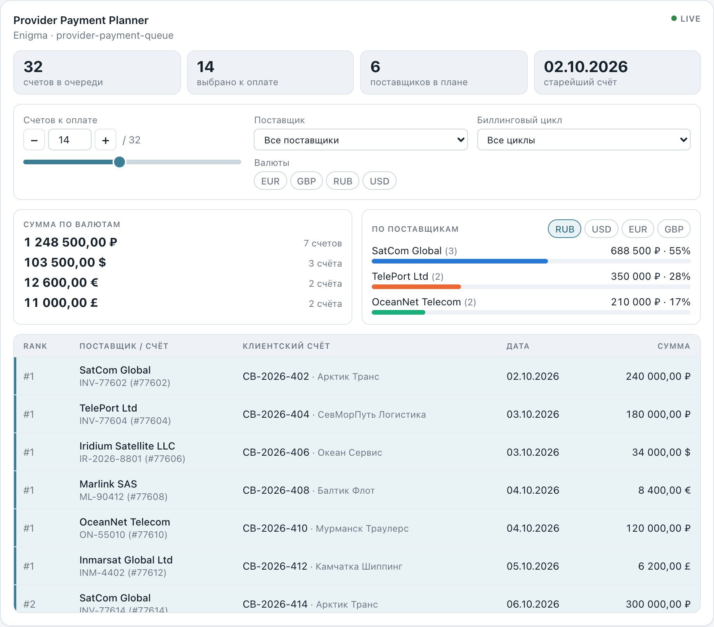
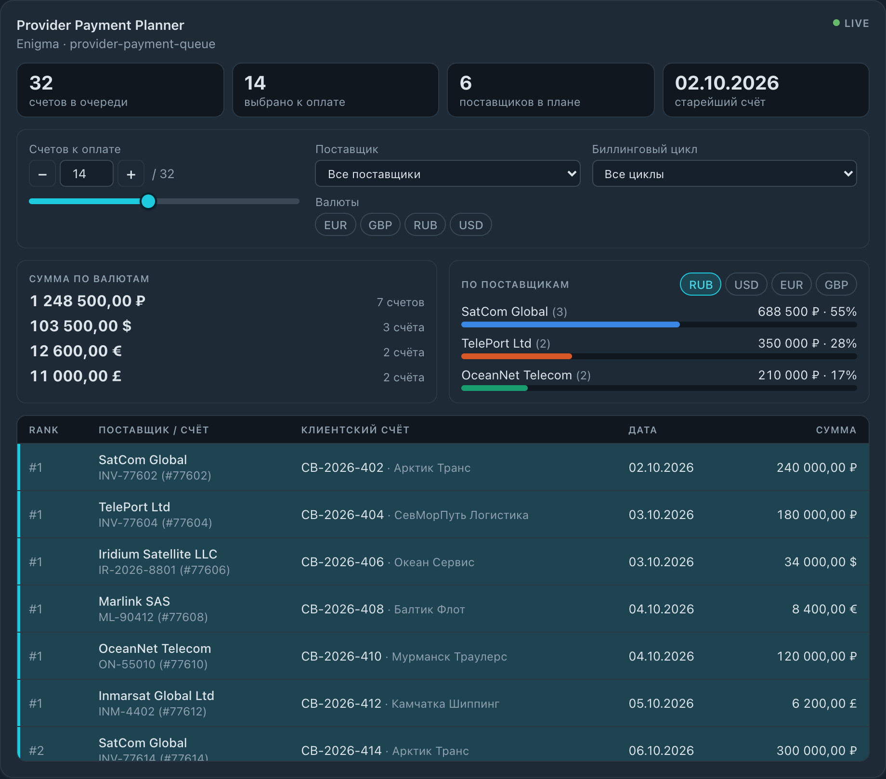
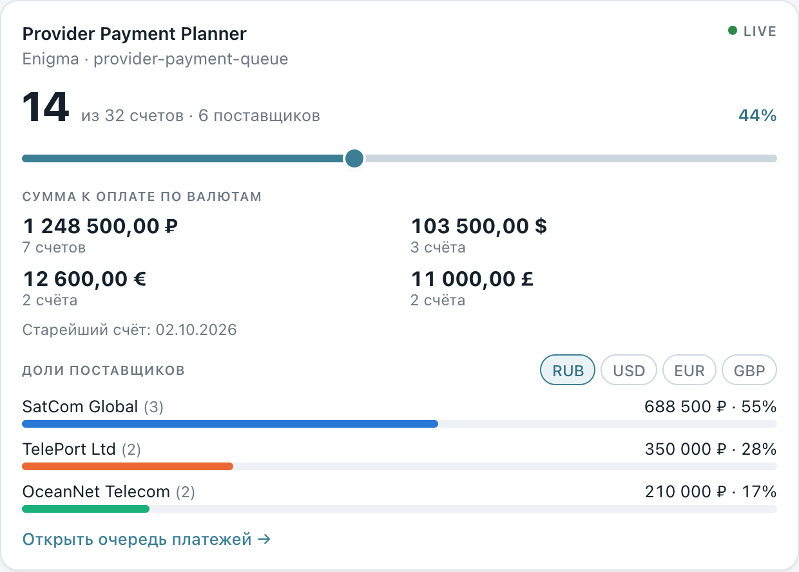
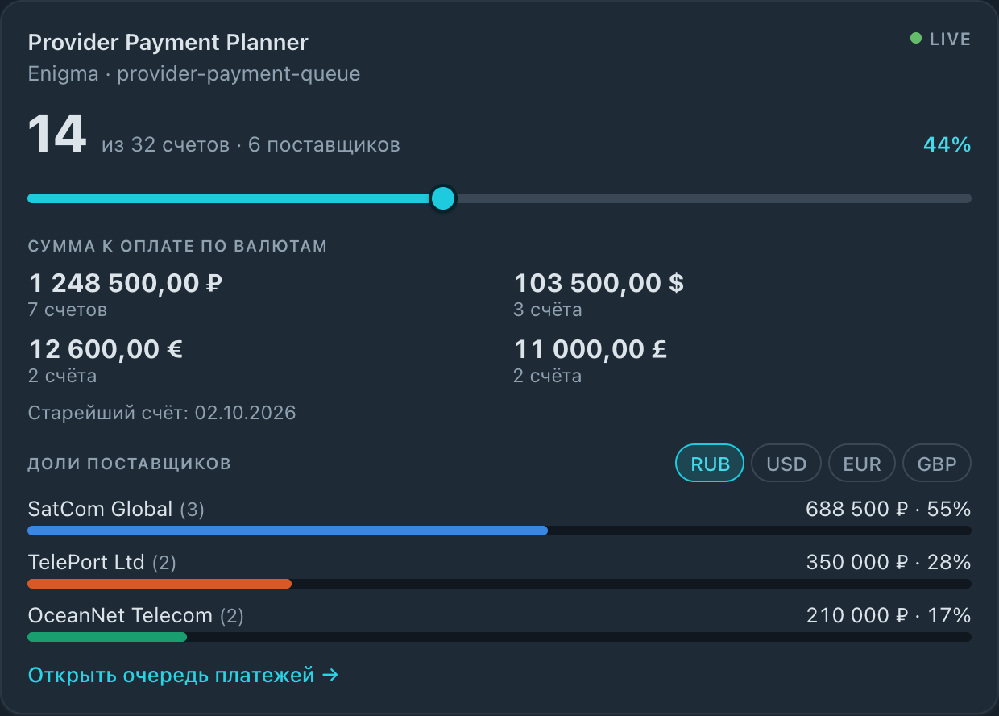
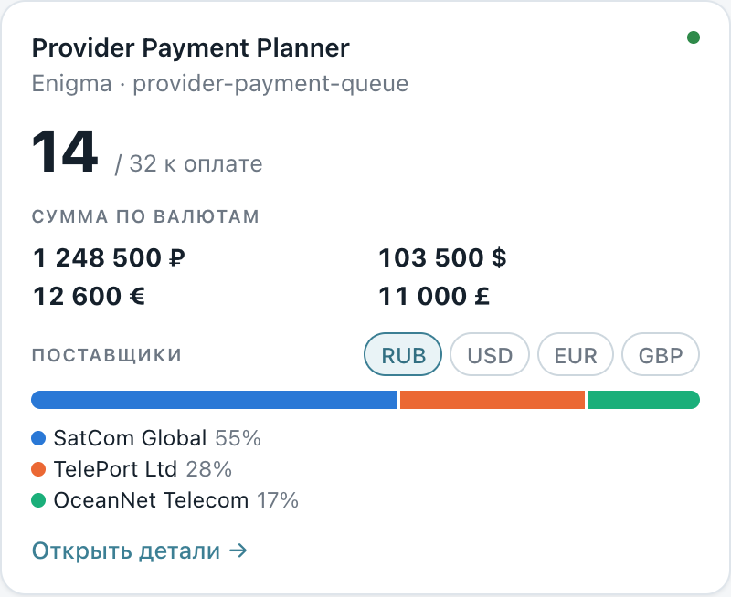
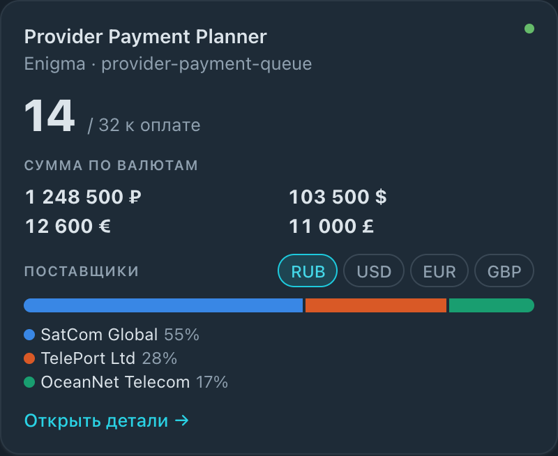
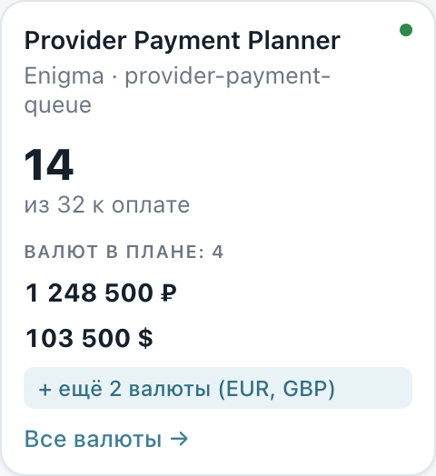
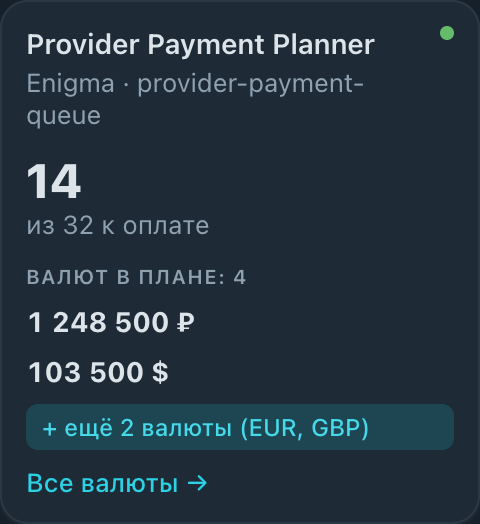

<div align="center">

# Provider Payment Planner Widget

**An interactive, read-only dashboard widget for the INTERA Core platform.**
Pick how many of the first bills in the payment queue to pay — see totals per currency and every provider's share.


[Quick start](#quick-start) ·
[Screenshots](#screenshots) ·
[Parameters](#parameters) ·
[Functionality](#functionality) ·
[Architecture](#architecture) ·
[Integration](#integrating-into-intera-core) ·
[Limitations](#known-limitations) ·
[Task statement (RU)](docs/TASK.ru.md)

</div>

---

## Contents

1. [Overview](#overview)
2. [Screenshots](#screenshots)
3. [Quick start](#quick-start)
4. [Usage](#usage)
5. [Parameters](#parameters)
6. [Functionality](#functionality) — [domain rules](#domain-rules) · [sizes](#what-each-size-shows) · [data states](#data-states)
7. [Architecture](#architecture) — [layout](#project-layout) · [conventions](#conventions) · [key decisions](#key-decisions)
8. [Testing](#testing)
9. [Integrating into INTERA Core](#integrating-into-intera-core)
10. [Third-party libraries](#third-party-libraries)
11. [Known limitations](#known-limitations)
12. [Where to find what](#where-to-find-what)

## Overview

The widget plans payments to providers from the `provider-payment-queue` data source of the
**Enigma** integration ([row type](src/types/provider-payment-queue.ts)). The user chooses how many of
the first bills of the *filtered* queue to pay (`selectedCount`) and gets the upcoming payments with
totals **per currency** and each provider's share **inside** its currency. It never changes data in Enigma.

Highlights:

- **Four card sizes** — `full`, `half`, `third`, `quarter` — each with its own layout, adapting to the card width.
- **Exact multi-currency math** — filter → sort → cut; amounts are summed per currency in minor units, never mixed or converted.
- **Defensive by design** — malformed params fall back to defaults; invalid amounts stay visible but are kept out of every sum.
- **All data states** — loading, background refresh, stale, error, empty — and the user's slider / open bill survive a refresh.
- **Light and dark themes** using only INTERA theme tokens; accessible controls; reduced-motion aware.
- **Runs offline** — the sandbox uses a bundled mock data set; React is the only runtime dependency.

> The original task statement (Russian) is kept in [`docs/TASK.ru.md`](docs/TASK.ru.md); the reference
> layout is [`reference-layout.svg`](reference-layout.svg).

## Screenshots

| Size | Light | Dark |
| --- | --- | --- |
| **XL** `full` (4×2) |  |  |
| **L** `half` (3×2) |  |  |
| **M** `third` (2×2) |  |  |
| **S** `quarter` (1×2) |  |  |

Data states — `full`:
[stale](docs/screenshots/full-state-stale.png) ·
[loading](docs/screenshots/full-state-loading.png) ·
[empty](docs/screenshots/full-state-empty.png) ·
[error](docs/screenshots/full-state-error.png);
`quarter`:
[loading](docs/screenshots/quarter-state-loading.png) ·
[error](docs/screenshots/quarter-state-error.png).

## Quick start

Requires **Node.js 20+** (see `engines` in [`package.json`](package.json)).

```bash
git clone https://github.com/llladno/intera-task-Provider-payment-planner-widget.git
cd intera-task-Provider-payment-planner-widget
npm install
npm run dev
```

| Command | What it does |
| --- | --- |
| `npm run dev` | Starts the interactive [sandbox](src/sandbox/sandbox-app.tsx) at <http://localhost:5173> (Vite picks the next free port if it is taken). |
| `npm test` | Runs all [tests](#testing) once (Vitest). |
| `npm run test:watch` | Tests in watch mode. |
| `npm run typecheck` | TypeScript in strict mode, no emit. |
| `npm run build` | Type-check plus production build into `dist/`. |

The sandbox lets you switch the card size (or show all four at once), the data state (`ready`, `stale`,
`refreshing`, `loading`, `empty`, `error`), the theme, and every widget parameter.

## Usage

```tsx
import { PaymentPlannerWidget } from '@/widget/payment-planner';

<PaymentPlannerWidget
  params={{ selectedCount: 14, currencyIds: [643, 840], rowLimit: 25 }}
  data={collectionData} // ICollectionDataResult<IProviderPaymentQueueRow>
  size="third"          // optional, overrides params.size
/>
```

| Prop | Type | Description |
| --- | --- | --- |
| `params` | `Record<string, unknown>` | Raw widget configuration from the dashboard layout — see [Parameters](#parameters). |
| `data` | [`ICollectionDataResult<IProviderPaymentQueueRow>`](src/platform/widget-types.ts) | The data envelope from `useCollectionData`. |
| `size` | `'full' \| 'half' \| 'third' \| 'quarter'` | Optional size from the host; wins over `params.size`. |

Public entry files: [`payment-planner.tsx`](src/widget/payment-planner.tsx) (widget),
[`payment-planner-params.ts`](src/widget/payment-planner-params.ts) (params parsing, defaults),
[`payment-planner-compute.ts`](src/widget/payment-planner-compute.ts) (plan computation and result types),
[`payment-planner-filters.ts`](src/widget/payment-planner-filters.ts) (filter options).

## Parameters

`params` is untyped on purpose (it comes from a dashboard layout). It is normalised by
[`parsePaymentPlannerParams`](src/widget/planner/model/params/parse-payment-planner-params.ts), which never
throws: every bad value falls back to its default ([defaults](src/widget/planner/config/defaults.ts)).
Numeric params accept real numbers only, as typed in the task statement (`'7'` is an error, not `7`).

| Parameter | Type | Default | Notes |
| --- | --- | --- | --- |
| `description` | `string` | `'Provider Payment Planner'` | Also reads `title`; trimmed. |
| `subtitle` | `string` | `''` | Trimmed. |
| `size` | `'full' \| 'half' \| 'third' \| 'quarter'` | `'full'` | Unknown value → `'full'`. The `size` prop wins over it. |
| `selectedCount` | `number` | `10` | Rounded, clamped to `>= 0`. Anything that is not a finite number (including `'7'`) → `10`. |
| `currencyIds` | `number[]` | `[]` | Unique finite numbers; empty = all currencies. |
| `providerId` | `number \| 'all'` | `'all'` | |
| `billingCycleId` | `number \| 'all'` | `'all'` | |
| `amountFormat` | `'grouped' \| 'plain'` | `'grouped'` | `1 248 500,00 ₽` or `1248500.00 ₽`. |
| `rowLimit` | `10 \| 25 \| 50 \| 100` | `10` | Reads `rowLimit`, then legacy `maxRows` if `rowLimit` is absent or not allowed. |
| `showCustomerBills` | `boolean` | `true` | Linked customer bills in the table and details. |
| `showProviderBreakdown` | `boolean` | `true` | Provider shares. |
| `showSummary` | `boolean` | `true` | Counters and per-currency totals. |

## Functionality

### Domain rules

Implemented in [`computePaymentPlan`](src/widget/planner/model/compute/compute-payment-plan.ts) — plain
TypeScript, no React or DOM.

| # | Rule | Source |
| --- | --- | --- |
| 1 | **Filter → sort → cut.** `providerId`, `billingCycleId` and `currencyIds` narrow the queue *before* the first `selectedCount` bills are taken. `effectiveSelectedCount = min(max(0, selectedCount), filteredQueue.length)`. | [`filter-queue.ts`](src/widget/planner/model/compute/filter-queue.ts), [`build-sorted-queue.ts`](src/widget/planner/model/compute/build-sorted-queue.ts) |
| 2 | **Sort order:** `payment_rank` ascending (a number or a numeric string; missing or invalid ranks go last) → `provider_bill_id` ascending → original order. Enigma numbers `payment_rank` *per provider*, so the bill id tie-break makes the queue deterministic. | [`sort-queue.ts`](src/widget/planner/model/compute/sort-queue.ts) |
| 3 | **Invalid amounts.** `provider_total_due` that is `null`, `''`, `0`, negative or not numeric flags the bill `hasInvalidAmount`. It stays in the queue, takes its position in the cut, is flagged in the table, and is **excluded** from `currencyTotals` and `providerBreakdown` (never counted as `0`). `invalidSelectedCount` counts the selected ones. A selected invalid bill reads "Некорректная сумма (исключена)"; one beyond the cut only "Некорректная сумма", because nothing was excluded on its account. | [`build-queue-item.ts`](src/widget/planner/model/compute/build-queue-item.ts), [`aggregate-selection.ts`](src/widget/planner/model/compute/aggregate-selection.ts) |
| 4 | **Currencies are never mixed.** Totals are grouped by `provider_currency_id`; there is no conversion. Sums are accumulated in minor units. | [`aggregate-selection.ts`](src/widget/planner/model/compute/aggregate-selection.ts), [`money.ts`](src/widget/planner/model/compute/money.ts) |
| 5 | **Shares** per `(provider, currency)` = `totalAmount / currencyTotal * 100`, so one currency sums to 100%. On screen they are whole percents distributed by the largest remainder method, so the *displayed* numbers add up to exactly 100 too; a real share that rounds to 0 reads `<1%`. | [`aggregate-selection.ts`](src/widget/planner/model/compute/aggregate-selection.ts), [`format-percent.ts`](src/widget/planner/lib/format/format-percent.ts) |
| 6 | **Customer bills** are shown when `customer_bill_no` is non-empty *and* `customer_total_due` is a valid number. | [`build-queue-item.ts`](src/widget/planner/model/compute/build-queue-item.ts) |

### What each size shows

| Size | Content | View |
| --- | --- | --- |
| `full` | Queue stats, slider + number input + `−`/`+`, in-widget filters (provider, cycle, currencies), per-currency totals, provider shares with a currency switch, the queue table with selected / invalid highlighting and expandable bill details (including the linked customer bill). "Show more" grows the table in `rowLimit` steps. | [`full-view.tsx`](src/widget/planner/ui/views/full-view.tsx) |
| `half` | `N of M` with the percentage, compact slider, all currencies, provider count, oldest selected bill, provider shares, "Open payment queue" (full view in a dialog). | [`half-view.tsx`](src/widget/planner/ui/views/half-view.tsx) |
| `third` | `N / M` counter, all currency totals, stacked provider strip with a currency switch, "Open details" (same dialog). | [`third-view.tsx`](src/widget/planner/ui/views/third-view.tsx) |
| `quarter` | Selected count and the first two currencies. When more exist it shows an explicit `+ ещё N валюты (EUR, GBP)` line and an "All currencies" toggle — currencies are never hidden silently or summed. | [`quarter-view.tsx`](src/widget/planner/ui/views/quarter-view.tsx) |

### Data states

Handled in [`payment-planner-widget.tsx`](src/widget/planner/ui/payment-planner-widget/payment-planner-widget.tsx).

| State | Behaviour |
| --- | --- |
| `loading && !loaded` | Skeleton inside the card. |
| `loading && loaded` | Widget stays mounted; slider position, filters and open bill details are preserved; "Обновление…" appears in the header. |
| `stale === true` | `<FreshnessMark source="rows" stale />` in the header (also when `loaded` is false). |
| `error && !loaded` | Error block (`role="alert"`). |
| `error && loaded` | Data (or the empty state) stays, with a warning that the refresh failed. |
| `loaded && items.length === 0` | Empty state. |
| Filters match nothing | A dedicated "queue is empty for these filters" state with a reset button. |

## Architecture

The widget follows a [Feature-Sliced-Design](https://feature-sliced.design)-like layout: one slice, split
into segments by responsibility — `config` → `lib` → `model` → `ui`. A segment only imports from segments
to its left; [`architecture.test.ts`](src/widget/planner/architecture.test.ts) enforces it.

### Project layout

```
src/
  widget/
    payment-planner.tsx            public entry (path fixed by the task) → ./planner
    payment-planner-params.ts      public entry → parsePaymentPlannerParams, AMOUNT_FORMATS, defaults
    payment-planner-compute.ts     public entry → computePaymentPlan and its result types
    payment-planner-filters.ts     public entry → collectFilterOptions (used by the sandbox)
    payment-planner.test.ts        tests of the public API (params + compute)
    planner/                       the slice
      config/                      constants and enums only: defaults, param keys, currencies,
                                   layout limits, labels (all visible text), plural forms, colors
      lib/                         pure helpers: formatting, messages, class names
      model/                       no JSX
        types.ts                   types shared by the slice (config, plan, filter options …)
        params/                    params → IPaymentPlannerConfig (defensive parsing)
        compute/                   pure plan computation: build the sorted queue (filter + sort),
                                   then select and aggregate — the two halves can be cached apart
        filter-options/            providers / billing cycles / currencies of the loaded rows
        use-planner-state/         slider / filters / row-limit state (+ its own types)
        use-widget-view-state/     which row / currency / dialog is open
        use-payment-planner/       config + state + plan + filter options for the card
      ui/                          one folder per component
        <component>/               <component>.tsx · .css · .types.ts · .constants.ts
        views/                     full / half / third / quarter views, picked by size
        payment-planner-widget/    the card: header, data states, dialog
  platform/                        INTERA primitives (theme, card, FreshnessMark, helpers) — provided
  sandbox/                         interactive playground, same layering (config / model / lib / ui)
  test/setup-ui.ts                 jsdom setup for UI tests
```

### Conventions

- **Imports.** No barrel (`index.ts`) files — every import points at the file that defines the symbol.
  Path aliases are declared once, in [`tsconfig.json`](tsconfig.json) `paths`; [`vite.config.ts`](vite.config.ts)
  reads them from there, so `tsc`, Vite and Vitest cannot disagree:
  `@/` → `src/`, `@platform/` → `src/platform/`, `@planner/` → `src/widget/planner/`, `@sandbox/` → `src/sandbox/`.
  There are no relative (`./`, `../`) imports in the widget, the sandbox and the tests — not even for a
  file next to the importer or its stylesheet. The three `./*.css` imports of the provided
  `src/platform/` were switched to `@platform/` as well.
- **Types.** Shared types live in [`model/types.ts`](src/widget/planner/model/types.ts); a component's own
  types sit next to it in `<component>.types.ts`. Interfaces are `IName`, type aliases `TName`, enums `EName`.
- **Constants and enums.** Shared ones in [`config/`](src/widget/planner/config); component-specific ones in
  `<component>.constants.ts` (for example `EButtonVariant`, `ECurrencyTotalsLayout`). There are no
  hard-coded visible strings or tunable numbers in components: text comes from
  [`LABELS`](src/widget/planner/config/labels.ts) / [`MESSAGES`](src/widget/planner/lib/messages.ts); limits,
  colors and counts from `config`. (A `switch` over the platform's `TWidgetSize` union keeps its literal cases.)
- **CSS** follows [BEM](https://getbem.com): one block per component, one stylesheet per component, prefix
  `dash-payment-planner-` (the sandbox uses `sandbox-`). Elements are flat (`block__element`), state and
  variants are modifiers (`block--modifier`, `block__element--modifier`), there are no tag or descendant
  selectors. The only compound selector is `.dash-payment-planner.dash-payment-planner--quarter`, which
  deliberately beats the platform `.dash-card` padding regardless of stylesheet order.
- **Names** are self-documenting (`queueRow`, `currencyTotal`, `widgetSize`, `dataStateMode`); no
  single-letter or abbreviated identifiers.

### Key decisions

- **Three layers.** `params` and `compute` are plain TypeScript with no React or DOM, so all business
  rules are unit-tested without rendering. The view only formats and lays out what `compute` returns.
- **Runtime state vs. config.** Interactive changes (slider, quick filters, "show more") are passed to
  `computePaymentPlan` as `IPaymentPlannerRuntimeState` overrides ([hook](src/widget/planner/model/use-planner-state/use-planner-state.ts))
  and never mutate `params`. If the host edits the matching param, the override is dropped and the new
  param wins, so a stale slider never shadows a setting.
- **State survives refreshes.** The state lives in the widget, which is never unmounted while
  `loading && loaded`. An open bill is tracked by a stable `billKey`, not by its position.
- **Money.** Amounts are accumulated in minor units (kopecks / cents) so repeated additions do not
  drift; formatting is done with `Intl` and never converts between currencies.
- **Cheap slider.** Sorting does not depend on the selected count, so the sorted queue is cached and
  dragging the slider only redoes the selection and aggregation.
- **Currency order** in the totals is the order of first appearance in the sorted queue; the **provider
  breakdown** is sorted by amount, descending.
- **Styling.** Only INTERA theme tokens ([`theme.css`](src/platform/theme.css)), light and dark themes. Layout
  adapts via `data-size` and container queries, so it follows the card width rather than the viewport.
- **Accessibility.** Native controls, labelled slider with `aria-valuetext`, `aria-pressed` toggles,
  `aria-expanded` rows, live regions for loading and errors, `prefers-reduced-motion` respected.

## Testing

`npm test` runs **111 tests in 11 files** ([Vitest](https://vitest.dev) +
[Testing Library](https://testing-library.com) on [jsdom](https://github.com/jsdom/jsdom)).

<details>
<summary>What each test file covers</summary>

| File | Covers |
| --- | --- |
| [`payment-planner.test.ts`](src/widget/payment-planner.test.ts) | Public API — `parsePaymentPlannerParams`, `computePaymentPlan` and the public contract: filter → sort → cut, invalid amounts, currencies never mixed, shares, ranks, overrides, stable `billKey`, cached sort = uncached plan, `AMOUNT_FORMATS` stays a literal tuple. |
| [`format.test.ts`](src/widget/planner/lib/format/format.test.ts), [`join-class-names.test.ts`](src/widget/planner/lib/join-class-names.test.ts) | Amount / percent / share / date / plural formatting, class-name joining. |
| [`collect-filter-options.test.ts`](src/widget/planner/model/filter-options/collect-filter-options.test.ts) | Filter options: distinct, sorted, fallback names for rows with missing names. |
| [`use-planner-state.test.tsx`](src/widget/planner/model/use-planner-state/use-planner-state.test.tsx), [`use-widget-view-state.test.tsx`](src/widget/planner/model/use-widget-view-state/use-widget-view-state.test.tsx) | Interactive state: slider override, filters, row limit, open bill / currency / dialog, and when overrides are dropped. |
| [`use-payment-planner.test.tsx`](src/widget/planner/model/use-payment-planner/use-payment-planner.test.tsx) | The card's model: the sort is not repeated while the slider moves, active currency, size prop vs `params.size`, non-array `items`. |
| [`payment-planner-widget.test.tsx`](src/widget/planner/ui/payment-planner-widget/payment-planner-widget.test.tsx) | The rendered widget: every data state, all four sizes, slider / number input / filters, bill details and customer bills, the `quarter` currency overflow, the dialog, state surviving a background refresh, details staying on the same bill, refresh error over an empty queue, invalid-row wording, `<1%`. |
| [`architecture.test.ts`](src/widget/planner/architecture.test.ts) | The layering (`config → lib → model → ui`), no barrels, no relative imports, the sandbox uses only the public entry files. |
| [`build-data-envelope.test.ts`](src/sandbox/lib/build-data-envelope.test.ts), [`use-sandbox-params.test.tsx`](src/sandbox/model/use-sandbox-params.test.tsx) | The sandbox's data envelopes and params state. |

</details>

jsdom has no modal `<dialog>`; [`src/test/setup-ui.ts`](src/test/setup-ui.ts) emulates `showModal()` / `close()`.
Layout and visuals are not covered by automated tests (jsdom has no layout engine); they were checked in
the sandbox in all four sizes, all six data states and both themes.

## Integrating into INTERA Core

Use the public entry files listed under [Usage](#usage). Everything under `src/widget/planner/` and
`src/platform/` imports through path aliases, so the host build must define the same ones:

| Alias | Target |
| --- | --- |
| `@/` | `src/` |
| `@platform/` | `src/platform/` |
| `@planner/` | `src/widget/planner/` |
| `@sandbox/` | `src/sandbox/` (sandbox only; not needed for the widget) |

In this repository they live in [`tsconfig.json`](tsconfig.json) (`compilerOptions.paths`) and are picked up
by [`vite.config.ts`](vite.config.ts) automatically. Copying the widget into another project without these
aliases makes every import fail to resolve — either add the aliases there or rewrite the imports. The
sandbox only uses the public entry files, so the widget's internals can move without breaking it.

## Third-party libraries

| Package | Use | License |
| --- | --- | --- |
| [`react`](https://react.dev), `react-dom` | UI | MIT |
| [`typescript`](https://www.typescriptlang.org) | Types | Apache-2.0 |
| [`vite`](https://vite.dev), [`@vitejs/plugin-react`](https://github.com/vitejs/vite-plugin-react) | Dev server and build | MIT |
| [`vitest`](https://vitest.dev) | Test runner | MIT |
| [`@types/node`](https://www.npmjs.com/package/@types/node) | Node typings for `vite.config.ts` and the architecture test (dev only) | MIT |
| [`jsdom`](https://github.com/jsdom/jsdom), [`@testing-library/react`](https://testing-library.com/docs/react-testing-library/intro), [`user-event`](https://testing-library.com/docs/user-event/intro), [`jest-dom`](https://github.com/testing-library/jest-dom) | UI tests (dev only) | MIT |

No other runtime dependencies and no bundled fonts or images.

## Known limitations

- **Fixture size.** The task statement and the reference layout mention 30 queue records, but the
  provided [`mock-payment-queue.json`](src/data/mock-payment-queue.json) contains **32**. The widget works
  on the actual data; the provided starter test that expected `30` was updated to `32`. The data file was
  not modified.
- **"Open payment queue" / "Open details"** open the full widget view in a dialog, because the host
  navigation target is not part of the task. Hooking them to host routing would mean adding an optional
  callback prop.
- **One row = one bill.** The task does not say what happens if the same provider bill arrives on several
  rows (e.g. one per linked customer bill). Rows are treated independently, so such a bill would be counted
  once per row. A row's identity (`billKey`) is its `provider_bill_id` plus the linked `customer_bill_id`,
  so open details follow the bill through refreshes and re-sorting; rows with the same pair open together.
- The table is not virtualised; `rowLimit` (max 100) plus "Show more" keep it small for typical queues.
- UI text is in Russian, matching the reference layout. There is no i18n layer.
- Aliases are required by the host build — see [Integrating into INTERA Core](#integrating-into-intera-core).

## Where to find what

| You are looking for | Go to |
| --- | --- |
| How to install and run | [Quick start](#quick-start) |
| What the widget does and its parameters | [Functionality](#functionality), [Parameters](#parameters) |
| Screenshots of the four sizes | [Screenshots](#screenshots) |
| Architecture, decisions, libraries | [Architecture](#architecture), [Third-party libraries](#third-party-libraries) |
| What is not done or deliberately different | [Known limitations](#known-limitations) |
| The original task and the reference layout | [`docs/TASK.ru.md`](docs/TASK.ru.md), [`reference-layout.svg`](reference-layout.svg) |
| The data source type | [`provider-payment-queue.ts`](src/types/provider-payment-queue.ts) |
